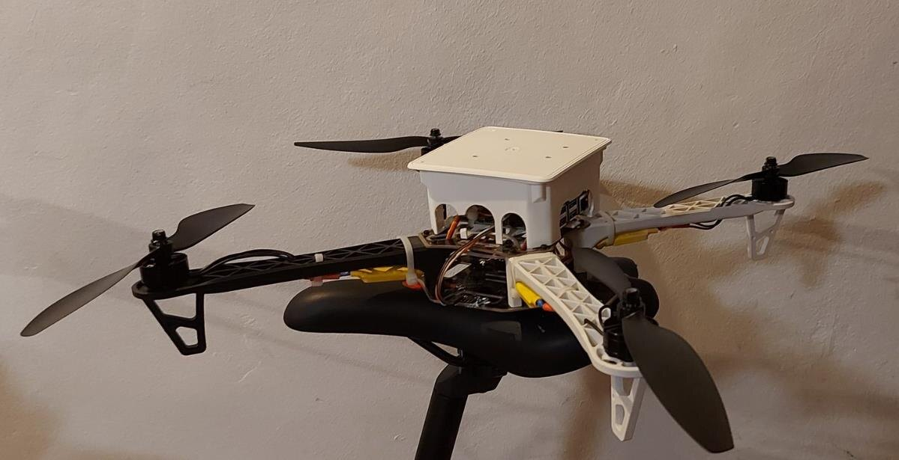
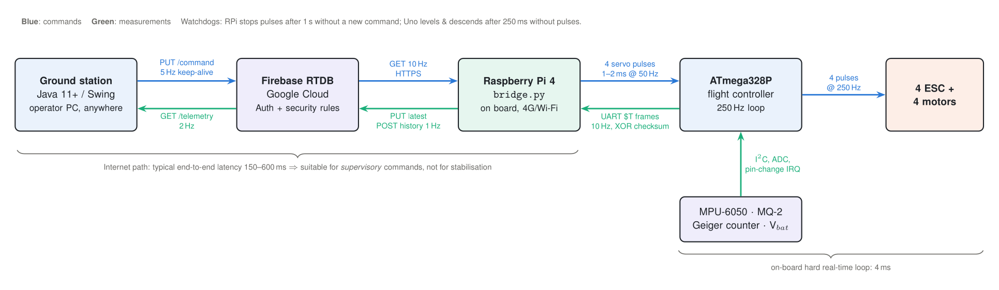

# Environmental monitoring drone for emergency situations

**Website:** <https://rendo117.github.io/environmental-monitoring-drone/>

A remotely piloted quadcopter that carries an **MQ-2 gas sensor** and a **Geiger–Müller counter**
into areas too dangerous for people. The operator controls it over the internet through a Firebase
real-time database and reads the measurements live.

Diploma project, *Faculty of Automation, Computers and Electronics, University of Craiova, 2022*
(“Dronă de colectare a datelor despre mediul înconjurător în situații de urgență”, Cristian-Mihail Chirea).
**Revised and extended edition, 2026:** corrected and completed source code, an extended mathematical model with
stability analysis and simulation, redrawn schematics, and authenticated communication.



## Architecture



```
Java ground station ──HTTPS──> Firebase RTDB ──HTTPS (4G/Wi-Fi)──> Raspberry Pi 4 ──servo pulses──> ATmega328P ──> 4 ESC + motors
        ^                          |                                     ^                              |
        └──── telemetry 2 Hz ──────┘ <──────── telemetry 1–10 Hz ─────────┴──── UART $T frames 10 Hz ────┘ <── MPU-6050, MQ-2, Geiger
```

## Repository layout

| Folder | Contents |
|---|---|
| [`firmware/`](firmware) | Arduino Uno flight controller: complementary filter, cascaded PID, arming, fail-safe, payload, telemetry. Includes a host-side test harness. |
| [`raspberry-pi/`](raspberry-pi) | `bridge.py`: Firebase ↔ servo pulses (pigpio), telemetry parsing, ppm/µSv/h conversion, watchdog, systemd unit, unit tests |
| [`ground-station/`](ground-station) | Java 11+ Swing app with no dependencies: login, stick/keyboard control, live telemetry, CSV, offline demo |
| [`firebase/`](firebase) | Security rules and set-up guide |
| [`simulation/`](simulation) | 6-DOF nonlinear model running the exact firmware control law, plus all result figures |
| [`hardware/`](hardware) | Schematics (CircuiTikZ sources, SVG, PNG, PDF), wiring table, bill of materials, original 2022 figures |
| [`documentation/`](documentation) | [Mathematical model](documentation/math-model.md) · [Errata](documentation/errata.md) · [Calibration](documentation/calibration.md) · [Safety & regulations](documentation/safety-and-regulations.md) |
| [`thesis/`](thesis) | The original 2022 thesis (PDF, Romanian) |
| [`docs/`](docs) | The generated website (GitHub Pages) |
| [`website/`](website) | Website sources and generator (`python3 website/build.py`) |

## Quick start

```bash
# 1. Flight controller: open firmware/flight_controller/flight_controller.ino in the Arduino IDE, board "Arduino Uno", upload.
#    Logic test without hardware:
cd firmware/host_test && g++ -std=gnu++17 -I. -x c++ main.cpp -o fc_test && ./fc_test

# 2. Raspberry Pi
sudo apt install pigpio python3-pigpio python3-serial python3-requests && sudo systemctl enable --now pigpiod
cd raspberry-pi && cp config.example.ini config.ini && python3 bridge.py --simulate

# 3. Ground station (any OS with JDK 11+)
cd ground-station && ./build.sh && java -jar build/ground-station.jar     # tick "Offline demo" to try it

# 4. Simulation
cd simulation && python3 quad_sim.py
```

Set up Firebase first ([`firebase/README.md`](firebase/README.md)), then follow the bench procedure in
[`documentation/calibration.md`](documentation/calibration.md) **with the propellers removed**.

## Key results of the revision

* **Stability:** with the thesis PID gains, the roll-rate loop has a **52° phase margin** and a **10.6 dB gain margin** (crossover 7.4 Hz).
* **Critical bug found:** the 2022 firmware integrated the pitch angle with the opposite sign of the pitch rate.
  The self-levelling loop then has a pole at *s* = +5 s⁻¹, and the simulated aircraft flips in about 0.6 s. Fixed.
* **Safety:** arming logic actually runs, there is a 250 ms link-loss fail-safe and a 1 s command watchdog, and the database is authenticated.
* **Telemetry completed:** gas (ppm-equivalent) and dose rate (µSv/h ± σ) now reach the operator.
* The full list of 50+ corrections is in [`documentation/errata.md`](documentation/errata.md).

## Safety and legal

This is a research prototype. The sensors are **uncalibrated and indicative only**. The Geiger board
generates **~400 V**. Flying beyond visual line of sight requires an authorisation from the Romanian Civil
Aeronautical Authority (AACR) under EU Regulation 2019/947. See
[`documentation/safety-and-regulations.md`](documentation/safety-and-regulations.md).

## Licence

* Code: [MIT](LICENSE)
* Documentation, schematics, figures, website text: [CC BY 4.0](LICENSE-docs.md)
* Original thesis PDF and photographs: © 2022 Cristian-Mihail Chirea, all rights reserved
* Third-party notices: [`THIRD_PARTY_NOTICES.md`](THIRD_PARTY_NOTICES.md). Citation: [`CITATION.cff`](CITATION.cff)
