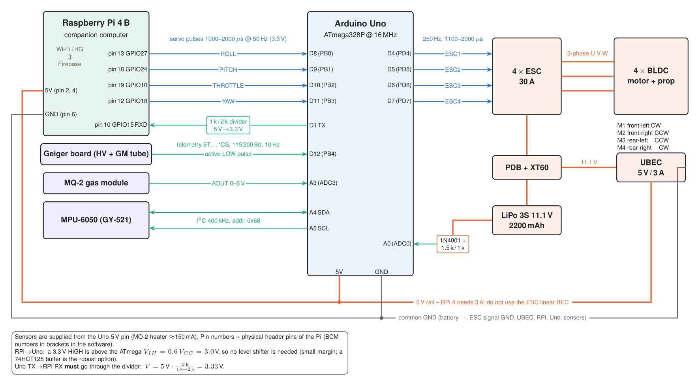

# Wiring

| From | To | Signal |
|---|---|---|
| RPi physical pin 13 (BCM27) | Uno D8 (PB0, PCINT0) | ROLL pulse |
| RPi physical pin 18 (BCM24) | Uno D9 (PB1, PCINT1) | PITCH pulse |
| RPi physical pin 19 (BCM10) | Uno D10 (PB2, PCINT2) | THROTTLE pulse |
| RPi physical pin 12 (BCM18) | Uno D11 (PB3, PCINT3) | YAW pulse |
| Uno D1 (TX) → 1 kΩ → node → 2 kΩ → GND | node → RPi physical pin 10 (BCM15 RXD) | telemetry 115 200 Bd |
| Geiger board OUT (Q2 collector) | Uno D12 (PB4, PCINT4) | active-LOW pulse |
| MQ-2 AOUT | Uno A3 | 0–5 V |
| MPU-6050 SDA / SCL | Uno A4 / A5 | I²C 400 kHz |
| Battery + → 1N4001 → 1.5 kΩ → node → 1 kΩ → GND | node → Uno A0 | V_A0 = 0.4·(V_bat − 0.8 V) |
| Uno D4, D5, D6, D7 | ESC1 (FL), ESC2 (FR), ESC3 (RL), ESC4 (RR) | 250 Hz pulses |
| UBEC 5 V | RPi pins 2/4, Uno 5V pin | 5 V / 3 A |
| all GND | common | |

Enable the Pi UART and free it from the console: `sudo raspi-config` → Interface → Serial →
login shell **No**, hardware **Yes**. The port is `/dev/serial0`.

Detailed sub-circuits: [`schematics/interfaces.svg`](schematics/interfaces.svg) · Geiger HV supply:
[`schematics/geiger.svg`](schematics/geiger.svg) · the original 2022 Fritzing diagram:
[`original-figures/fritzing-wiring.png`](original-figures/fritzing-wiring.png).
